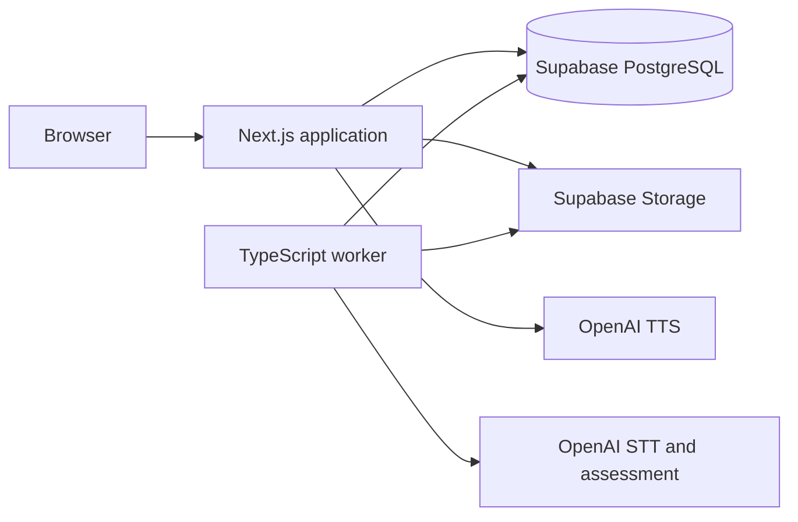

# Current Architecture Overview

## System Shape

Speakora is currently a TypeScript modular monolith with two runtime processes:



- The Next.js 15 App Router application serves the UI and HTTP APIs.
- Supabase PostgreSQL stores the question bank, speaking practice sessions, vocabulary practice content/sessions, learner progress, answers, transcripts, jobs, and assessments.
- The private `speaking-answers` Supabase Storage bucket stores recorded answers.
- A long-running Node.js worker claims durable jobs from PostgreSQL and performs STT and assessment.
- OpenAI calls are server-side and accessed through a shared provider abstraction.

There is no separate FastAPI service, Redis queue, or Python worker in the implemented repository.

## Entry Points

| Path | Responsibility |
| --- | --- |
| `src/app/page.tsx` | Redirects unauthenticated visitors to sign-in and authenticated learners to onboarding or the dashboard. |
| `src/app/onboarding/page.tsx` | Requires an authenticated session and collects the initial learner profile and daily answer goal. |
| `src/app/(learn)/dashboard/page.tsx` | Shows authenticated daily progress, streak, XP, recommendations, and recent activity. |
| `src/app/(learn)/explore/page.tsx` | Lists available General English topics with URL-backed search and level filters. |
| `src/app/(learn)/history/` | Lists owned sessions and reuses the authorized result/audio experience for detail. |
| `src/app/(learn)/profile/page.tsx` | Edits learner settings/goals, shows progress totals, and summarizes four skills from the latest completed owned General session. |
| `src/app/(learn)/vocabulary/` | Topic-based Vocabulary Practice flashcards (self-review, no typing/STT). |
| `src/app/(learn)/pronunciation/` | Authenticated word/IPA practice: topic selection, recording, normalized syllable feedback, saved-session resume, and weak-word practice. |
| `src/app/demo/speech/page.tsx` | Client-side five-question practice state machine, recording, upload, polling, and results. |
| `src/app/api/practice/sessions/route.ts` | Creates an authenticated IELTS session when a user is signed in, otherwise a guest IELTS session; both use fixed question snapshots. |
| `src/app/api/practice/sessions/[sessionId]/` | Uploads answers, returns status/results, and retries failed jobs. |
| `src/app/api/vocabulary/sessions/` | Creates vocabulary sessions, loads items, saves Remembered/Not remembered, and word TTS. |
| `src/app/api/pronunciation/` | Creates and loads owned word-pronunciation sessions, synthesizes authorized snapshot words, analyzes private attempts, and explicitly retries failed or stale attempts. |
| `src/app/api/speech/tts/route.ts` | Authorizes a session question and returns generated question audio. |
| `src/app/api/questions/random/route.ts` | Legacy/demo random-question endpoint supporting IELTS, TOEIC, and General modes. |
| `src/app/api/demo/speech/route.ts` | Legacy synchronous TTS/STT demo endpoint. It is not used by the five-question background flow. |
| `src/worker/index.ts` | Polling worker for `STT` and `ASSESSMENT` jobs. |

## Module Boundaries

Vocabulary Learning V2 adds `/vocabulary-learning`, `/api/vocabulary-learning/sessions`, and `src/modules/vocabulary-learning/` as an orchestration layer over the existing vocabulary and pronunciation domains. See [Vocabulary Learning V2](vocabulary-learning-v2.md) for the flow, state rules and persistence contract.

- `src/modules/practice/`: guest-token handling, shared DTOs, session authorization, and Supabase repositories.
- `src/modules/vocabulary/`: vocabulary session create/load, self-reviews, topic availability, and item selection.
- `src/modules/dashboard/`: bounded dashboard aggregation, opaque history pagination, and safe learner-facing DTOs.
- `src/modules/audio/`: upload size and MIME validation.
- `src/modules/pronunciation-analysis/`: Azure scripted/unscripted pronunciation assessment, PCM WAV conversion, simple speech metrics, and versioned provider-neutral results.
- `src/modules/pronunciation-practice/`: owned session/attempt persistence, scoring, idempotent processing, and retry coordination.
- `src/components/pronunciation/`: learner start/session/summary UI and provider-neutral client helpers. `src/components/audio/` owns the separate MediaRecorder lifecycle used here.
- `src/modules/ai-gateway/`: `TextToSpeechProvider`, `SpeechToTextProvider`, `AssessmentProvider`, and the OpenAI implementation.
- `src/lib/supabase/`: validates server environment and constructs public/admin Supabase clients plus request-scoped cookie-backed authentication clients.
- `supabase/migrations/`: creates the implemented schema, Storage bucket, RPC transactions, RLS, and job-claiming function.

Route handlers validate transport input and delegate shared operations to these modules. The worker reuses the AI gateway but creates its own service-role Supabase client because it runs outside Next.js.

## Runtime and Deployment

Development output uses `.next-dev`; production build/start use `.next`.
This prevents a verification build from overwriting chunks served by an active
development server.

Run the web application and worker as separate long-running processes from the same repository:

```powershell
npm run dev
npm run worker
```

Production requires applying all SQL migrations, configuring server-only environment variables, deploying Next.js, and keeping at least one worker process alive. The browser requires localhost or HTTPS for microphone access.

## Current Scope

Learner needs now support multiple selections through
`profiles.learning_purposes` (migration `202610220001_multiple_learning_needs.sql`).
The existing single `learning_purpose` remains a compatibility value; IELTS is
preferred there when selected. Profile and onboarding share checkbox controls.
Selecting IELTS alongside any other need requires a target band; omitting IELTS
clears the band. The extended onboarding RPC saves the array atomically with
the other preferences and backfills preexisting single selections.

The shared preference form filters unsupported legacy free-text goals when
initializing checkbox selections. If none remain, it uses the supported primary
goal or the existing General communication default. This prevents invisible
legacy selections from blocking profile saves under strict API validation;
stored data changes only when the learner saves the form.

Implemented scope includes guest and authenticated IELTS sessions plus cookie-backed learner authentication, onboarding, prepared-topic General English practice, mode-specific assessment, progress rewards, personalized recommendations, dashboard, history, and profile editing. Signed-in IELTS sessions are user-owned and appear in the existing history; anonymous sessions retain guest-token ownership. Main navigation links Home, Vocabulary, Pronunciation, Topic Conversation, IELTS, and Profile; history remains linked from dashboard/profile. The shared learner header exposes logout through the existing Supabase server action. Light/dark selection uses existing CSS tokens, follows system preference initially, and persists locally. Dashboard includes a local SVG illustration. TOEIC remains unavailable and has no home card; `/demo/speech` stays directly available for guest regression testing.

Profile includes a four-axis English Skills radar for Listening, Speaking, Reading, and Writing. It shows the latest persisted Speaking result from either Quick Speaking Check (CEFR) or IELTS Speaking (estimated band), whichever completed most recently. A separate visualization layer maps CEFR or IELTS values onto chart geometry while the UI continues to display the original value and scale. Listening, Reading, and Writing remain explicitly `Not assessed` because the implemented schema has no assessment source for them; their center position is a rendering fallback, not a measured zero. A failed read is shown as unavailable rather than as missing learner history. The existing detailed skill cards continue to reuse the latest completed ordinary General assessment and stored audio feedback, showing qualitative remarks rather than numeric skill scores. Onboarding and Profile share CEFR choices, ten multi-select learning needs (stored in `learning_purposes`, with a legacy `learning_purpose` compatibility value), an IELTS-only target band, daily minutes and existing topic preferences. Timezone is detected automatically. Legacy difficulty and answer-based XP/streak calculations remain unchanged; daily minutes are a preference, not tracked study time.

Onboarding offers a three-question Quick Speaking Check using the existing practice pipeline. Unknown-level learners must finish it; self-selected CEFR learners may skip. The compact result estimates CEFR from transcripts and gives short feedback/recommendation, without pronunciation analysis or scores. Check sessions are excluded from ordinary practice history, topic counts, rewards and skill recommendations. Development-only Profile reset clears only `onboarding_completed_at`; both API and repository block it in production.

General results project stored Azure metadata, plus locally calculated WPM, long pauses, conservative filler matches and adjacent repetitions, into a score-free presentation DTO with analysis coverage and at most three ranked unique words. Azure numeric scores remain internal. Stored Lingolix V1 results remain readable for historical sessions.

The General-only result layout presents completion and existing feedback first, followed by pronunciation, criteria, grouped coaching, a useful phrase, compact rewards and closed answer-review disclosures. Pronunciation self-practice is an inline reading guide, not a new recording or assessment flow. Existing authorized audio is fetched only on explicit playback. IELTS retains its prior result layout and transcript-only pronunciation disclosure.
